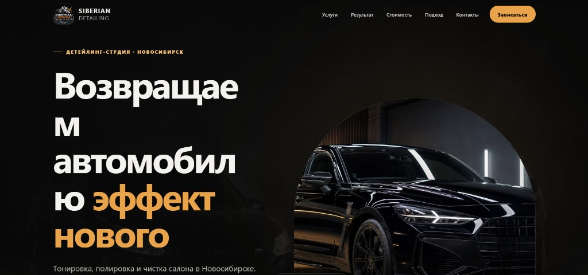
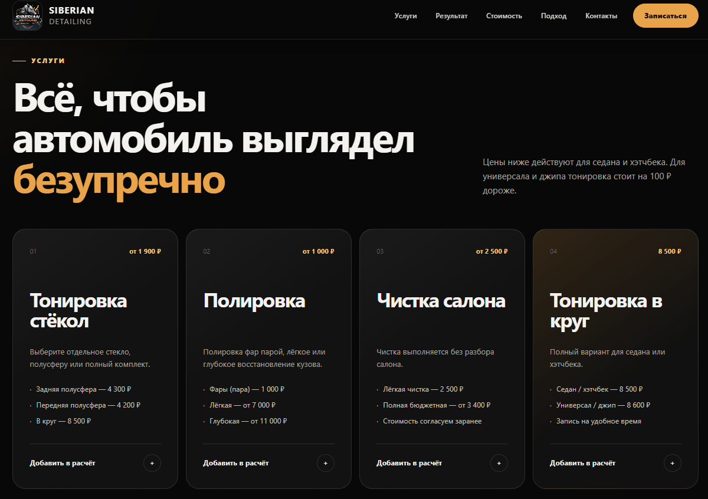
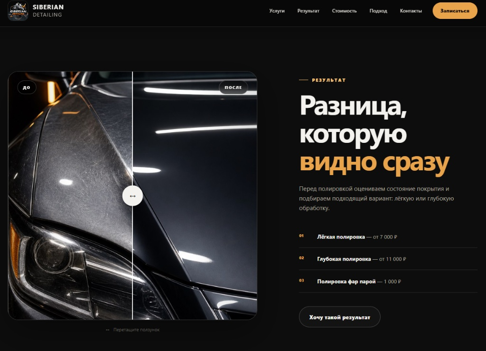
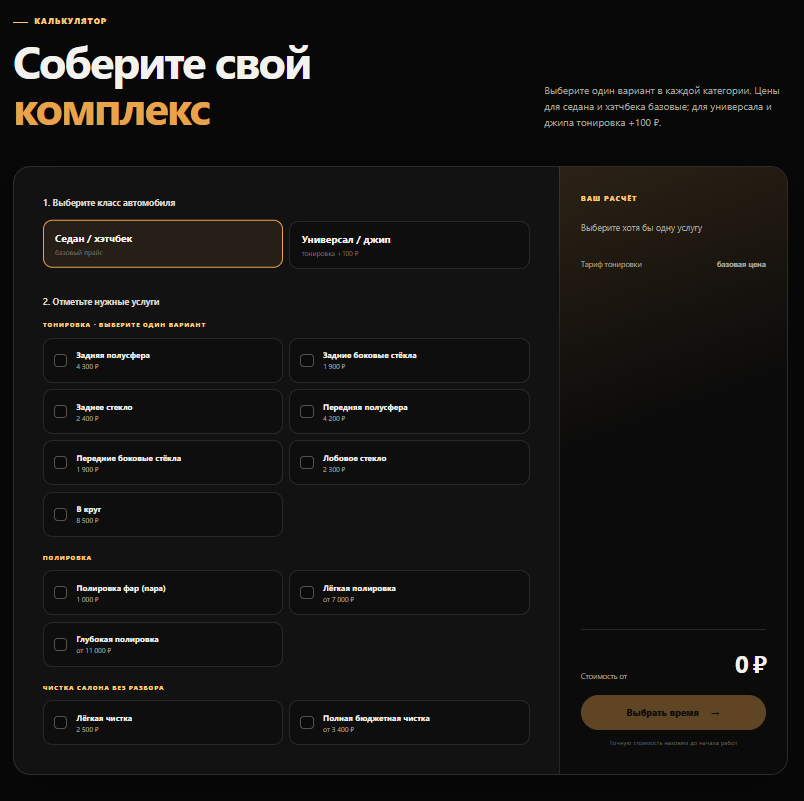
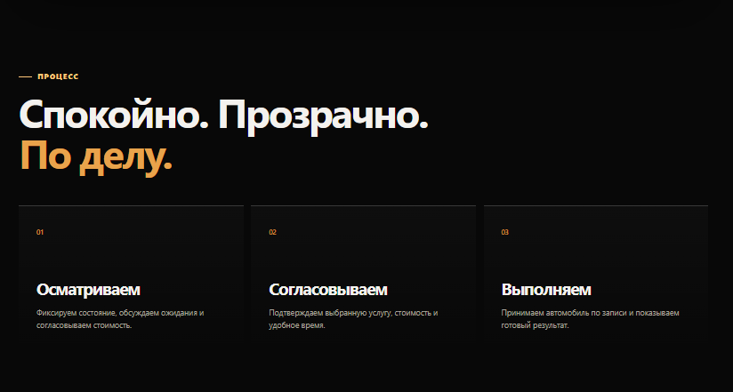
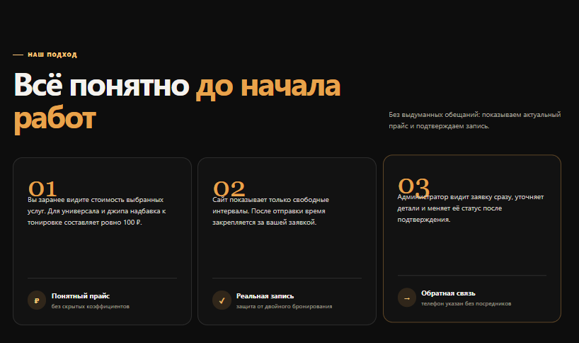
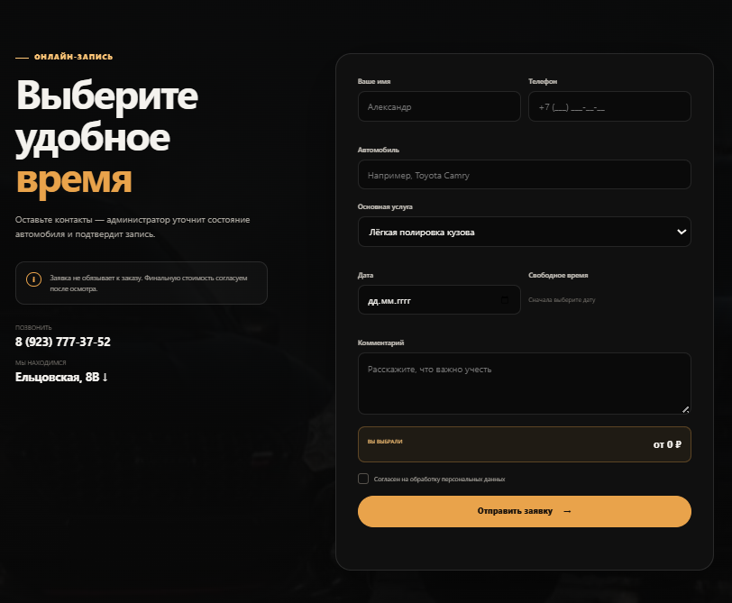
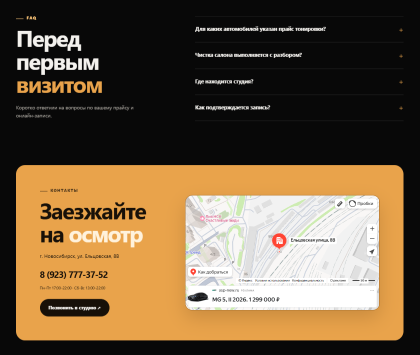

# Siberian Detailing — Веб-сайт детейлинг-студии

Веб-приложение для детейлинг-студии в г. Новосибирск с интерактивным калькулятором услуг, демонстрацией результатов работы и формой онлайн-записи с выбором свободного времени.

---

##  Технологии

* **Frontend:** HTML5, CSS3, JavaScript (ES6+)
* **Backend:** Node.js, Express (`server.js`)
* **Интеграции:** Яндекс.Карты API

---

##  Обзор страниц и функционала сайта

### 1. Главный экран (Hero Section)


* **Назначение:** Привлечение внимания пользователя и позиционирование студии.
* **Функционал:**
  * Шапка сайта (навигация по разделам: *Услуги, Результат, Стоимость, Подход, Контакты*).
  * Кнопка быстрого перехода к записи (**«Записаться»**).
  * Четкое УТП: *«Возвращаем автомобилю эффект нового»*.
  * Указание города работы (Новосибирск) и ключевых направлений (тонировка, полировка, чистка салона).

---

### 2. Каталог услуг и базовый прайс


* **Назначение:** Ознакомление клиента с основными категориями работ и стартовыми ценами.
* **Функционал:**
  * Интерактивные карточки услуг:
    1. **Тонировка стёкол** (занятие полусферы, в круг и т.д.).
    2. **Полировка** (фары, лёгкая или глубокая полировка кузова).
    3. **Чистка салона** (без разбора салона).
    4. **Тонировка в круг**.
  * Информирование о зависимости цены от типа кузова (надбавка на универсал/джип).
  * Кнопки **«Добавить в расчёт»** для быстрого формирования заказа.

---

### 3. Демонстрация результатов (Интерактивный слайдер До/После)


* **Назначение:** Наглядная демонстрация качества полировки и восстановления лакокрасочного покрытия.
* **Функционал:**
  * Интерактивный сравнительный ползунок (**Before/After Slider**), позволяющий пользователю плавно перемещать разделитель и видеть эффект «До» и «После» проведения работ.
  * Карточка с быстрым описанием вариантов полировки и кнопка **«Хочу такой результат»**.

---

### 4. Интерактивный калькулятор комплекса услуг


* **Назначение:** Самостоятельный расчёт стоимости под параметры автомобиля клиента.
* **Функционал:**
  * **Шаг 1:** Выбор класса автомобиля (*Седан / Хэтчбек* или *Универсал / Джип*).
  * **Шаг 2:** Множественный выбор конкретных услуг (тонировка отдельных стёкол, фары, полировка кузова, чистка салона).
  * **Динамический перерасчёт:** Итоговая сумма обновляется на лету в боковой панели **«Ваш расчёт»**.
  * Кнопка перехода к выбору времени с сохраненным расчетом.

---

### 5. Процесс работы


* **Назначение:** Повышение доверия клиентов за счет прозрачной схемы взаимодействия.
* **Функционал:**
  * Наглядные шаги выполнения заказа:
    1. **Осматриваем:** Фиксация состояния авто, согласование ожиданий и стоимости.
    2. **Согласовываем:** Подтверждение выбранной услуги и времени.
    3. **Выполняем:** Приём авто и качественная работа.

---

### 6. Наш подход и преимущества


* **Назначение:** Объяснение принципов работы студии.
* **Ключевые блоки:**
  * **Понятный прайс:** Отсутствие скрытых коэффициентов и наценок.
  * **Реальная запись:** Защита от двойного бронирования и показ только свободных интервалов времени.
  * **Прямая обратная связь:** Прямой контакт с администратором без посредников.

---

### 7. Форма онлайн-записи


* **Назначение:** Сбор заявок от клиентов с привязкой к свободным слотам.
* **Функционал:**
  * Поля ввода: Имя, Телефон (с маской ввода), Марка/Модель автомобиля, Пожелания/Комментарий.
  * Выбор основной услуги из выпадающего списка.
  * Выбор даты и динамическая загрузка **свободного времени** с сервера.
  * Автоматический подтяг итоговой стоимости из калькулятора.
  * Галочка согласия на обработку персональных данных.

---

### 8. FAQ и Контактная информация


* **Назначение:** Ответы на часто задаваемые вопросы и навигация к студии.
* **Функционал:**
  * **FAQ (Аккордеон):** Раскрывающиеся ответы на популярные вопросы о тонировке, чистке и процессе подтверждения записи.
  * **Интерактивная карта:** Встроенная карта Яндекс с точным маркером расположения студии (г. Новосибирск, ул. Ельцовская, 8В).
  * График работы и прямая кнопка для звонка в студию.

---

## Как запустить проект локально

1. Клонируйте репозиторий:
   ```bash
   git clone [https://github.com/mrplaksin2017-cell/Sibirian-detail-nsk.git](https://github.com/mrplaksin2017-cell/Sibirian-detail-nsk.git)
